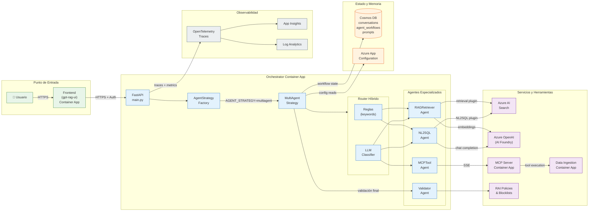

# Factibilidad de Soporte Multiagente con Agent Framework — GPT-RAG

> **Proyecto**: GPT-RAG (Azure/gpt-rag) v2.5.1  
> **Fecha de análisis**: 10 de abril de 2026  
> **Alcance**: Evaluación técnica, operativa y arquitectónica para integrar una solución multiagente coordinada con Microsoft Agent Framework.

---

## Tabla de Contenidos

- [1. Resumen Ejecutivo de Viabilidad](#1-resumen-ejecutivo-de-viabilidad)
- [2. Estado Actual del Repositorio](#2-estado-actual-del-repositorio)
- [3. Criterios de Evaluación de Factibilidad (Scorecard)](#3-criterios-de-evaluación-de-factibilidad-scorecard)
- [4. Mapa de Agentes Propuestos](#4-mapa-de-agentes-propuestos)
- [5. Estrategia de Integración con Agent Framework](#5-estrategia-de-integración-con-agent-framework)
- [6. Brechas, Riesgos y Mitigaciones](#6-brechas-riesgos-y-mitigaciones)
- [7. Plan de Implementación por Fases](#7-plan-de-implementación-por-fases)
- [8. Veredicto Final](#8-veredicto-final)
- [9. Diagrama de Integración Multiagente](#9-diagrama-de-integración-multiagente)

---

## 1. Resumen Ejecutivo de Viabilidad

### Diagnóstico

- El repositorio **ya implementa un patrón de estrategia extensible** (`BaseAgentStrategy` ABC + `AgentStrategyFactory`) que selecciona estrategias de agentes en runtime mediante la clave de configuración `AGENT_STRATEGY` (evidencia: `AGENTS.md`, sección orchestrator strategies).
- Existen **placeholder keys registrados** en el enum `AgentStrategies` para `multiagent` y `multimodal`, indicando que la arquitectura fue diseñada anticipando extensión multiagente (evidencia: `src/strategies/agent_strategies.py` en `gpt-rag-orchestrator`).
- La estrategia `nl2sql` **ya opera como flujo multiagente** con Triage, SQL Query y Synthesizer agents coordinados por Semantic Kernel `AgentGroupChat` (evidencia: `AGENTS.md`, tabla de estrategias).
- La estrategia `mcp` demuestra **integración dinámica de herramientas** vía MCP protocol SSE, con descubrimiento y ejecución en runtime (evidencia: `gpt-rag-mcp` repo, `src/server.py`).
- La infraestructura soporta **4 Container Apps independientes** (orchestrator, frontend, dataingest, mcp) desplegadas en Azure Container Apps Environment con managed identities y RBAC granular (evidencia: `main.parameters.json` L161-L236).
- Azure App Configuration actúa como **fuente centralizada de configuración** con label `gpt-rag`, permitiendo activar/desactivar estrategias sin redespliegue (evidencia: `config/aifoundry/appconfig.py`).
- El sistema de **observabilidad ya incluye** App Insights, Log Analytics y OpenTelemetry en el orchestrator (evidencia: `main.parameters.json` flags `deployAppInsights`, `deployLogAnalytics`).
- Cosmos DB almacena **conversaciones, datasources, prompts y datos MCP** en contenedores separados, proporcionando una base para estado compartido entre agentes (evidencia: `main.parameters.json` `databaseContainersList`).
- La **seguridad está madura**: Entra ID OAuth 2.0 + RBAC por documento + managed identities entre todos los servicios (evidencia: roles en `containerAppsList`, `AGENTS.md` sección Security).
- El patrón multi-repo con `manifest.json` permite **versionado independiente** de cada componente, facilitando la adición de nuevos servicios de agentes (evidencia: `manifest.json`).

### Nivel de Viabilidad Inicial: **Alta**

**Justificación**: GPT-RAG fue **diseñado explícitamente** para extensión multiagente. El patrón de estrategia, los placeholders `multiagent`/`multimodal`, la experiencia comprobada con `NL2SQLStrategy` (multiagente funcional), la infraestructura de Container Apps con RBAC, y la configuración centralizada proporcionan una base sólida. Las brechas principales son de implementación (contratos formales entre agentes, memoria compartida estructurada) más que de arquitectura fundamental.

---

## 2. Estado Actual del Repositorio

### 2.1 Arquitectura Actual

GPT-RAG sigue una **arquitectura multi-repo distribuida** con los siguientes componentes desplegados como Container Apps independientes:

| Componente | Repositorio | Container App | Rol |
|---|---|---|---|
| Platform Core | `Azure/gpt-rag` | — | Infraestructura, configuración y orquestación del despliegue |
| Orchestrator | `Azure/gpt-rag-orchestrator` v2.4.2 | `orchestrator` | FastAPI backend con patrón de estrategia de agentes |
| Data Ingestion | `Azure/gpt-rag-ingestion` v2.2.3 | `dataingest` | Procesamiento de documentos y embeddings |
| Web UI | `Azure/gpt-rag-ui` v2.2.2 | `frontend` | Interfaz Chainlit conversacional |
| MCP Server | `Azure/gpt-rag-mcp` v0.3.5 | `mcp` | Servidor MCP con herramientas, recursos y prompts |

**Patrón arquitectónico**: Microservicios containerizados con orquestación basada en estrategia + event-driven parcial (MCP vía SSE).

**Motor de orquestación**: `AgentStrategyFactory` en el orchestrator selecciona en runtime entre:
- `single_agent_rag` → Azure AI Foundry Agent Service
- `nl2sql` → Semantic Kernel Agents (multiagente con GroupChat)
- `mcp` → Semantic Kernel + MCP SSE Plugin

### 2.2 Puntos de Extensión Disponibles

| Punto de Extensión | Ubicación | Mecanismo | Estado |
|---|---|---|---|
| Nuevas estrategias de agente | `src/strategies/` (orchestrator) | Extender `BaseAgentStrategy`, registrar en enum + factory | Listo para uso |
| Placeholder `multiagent` | `agent_strategies.py` | Key registrado en enum, sin implementación | Placeholder |
| Placeholder `multimodal` | `agent_strategies.py` | Key registrado en enum, sin implementación | Placeholder |
| Plugins de Semantic Kernel | `src/plugins/` (orchestrator) | Plugins modulares (retrieval, nl2sql, common) | Listo para uso |
| Prompts configurables | `src/prompts/` + Cosmos DB | Jinja2 file-based o Cosmos DB-backed | Listo para uso |
| MCP herramientas | `src/tools/` (mcp) | Registro de tools MCP vía `server.py` | Listo para uso |
| MCP recursos y prompts | `src/resources/`, `src/prompts/` (mcp) | Definiciones expuestas por el servidor MCP | Listo para uso |
| Container Apps | `main.parameters.json` | Agregar entrada en `containerAppsList` | Requiere redeploy de infra |
| Storage Queues (MCP) | MCP tiene `StorageQueueDataContributor` | Capacidad de mensajería asíncrona | Existe permiso, no evidencia de uso |

### 2.3 Restricciones Actuales

| Restricción | Impacto | Evidencia |
|---|---|---|
| **Estrategia única activa**: Solo una estrategia seleccionada globalmente por `AGENT_STRATEGY` | No permite routing dinámico entre estrategias por query | `AGENTS.md`: "factory selects the active strategy at runtime based on `AGENT_STRATEGY`" |
| **Sin bus de eventos formal**: Comunicación entre servicios es HTTP directa (HTTPS entre Container Apps) | No hay pub/sub nativo para coordinación asíncrona entre agentes | `infra/modules/container-apps/container-apps-list.bicep`: endpoints expuestos como HTTPS |
| **Cosmos DB como estado pero sin esquema de coordinación**: Contenedores existentes son `conversations`, `datasources`, `prompts`, `mcp` | No existe un contenedor dedicado para estado de workflow multiagente | `main.parameters.json`: `databaseContainersList` |
| **Prompt management no versionado**: Prompts en archivos Jinja2 o Cosmos DB sin control de versiones formal | Drift de prompts entre agentes puede ocurrir sin detección | `AGENTS.md`: "file-based with Jinja2 or Cosmos DB-backed" |
| **MCP limitado a SSE unidireccional**: El servidor MCP expone herramientas pero el protocolo SSE es unidireccional (server→client) | Comunicación bidireccional entre agentes requiere extensión | `AGENTS.md`: "MCPSsePlugin", transporte SSE |

---

## 3. Criterios de Evaluación de Factibilidad (Scorecard)

| # | Criterio | Puntaje (0-5) | Evidencia | Gap | Acción Recomendada |
|---|---|---|---|---|---|
| 1 | **Modularidad y separación de responsabilidades** | 5 | Patrón Strategy con ABC (`BaseAgentStrategy`), Factory, plugins separados por dominio (`retrieval/`, `nl2sql/`, `common/`). Repos independientes por componente (`manifest.json`). | Ninguno significativo | Mantener patrón actual al agregar nuevos agentes |
| 2 | **Capacidad de orquestación/routing actual** | 4 | `AgentStrategyFactory` selecciona estrategia en runtime; `NL2SQLStrategy` ya implementa routing multiagente con `AgentGroupChat` de Semantic Kernel. Placeholders `multiagent`/`multimodal` registrados. | Routing es global (una estrategia activa), no por query/intención | Implementar `MultiAgentStrategy` que haga routing dinámico internamente |
| 3 | **Contratos de entrada/salida entre componentes** | 3 | FastAPI schemas en `src/schemas.py`, MCP protocol define contratos tool/resource. Container Apps se comunican por HTTPS con endpoints configurados en App Config. | Sin esquema formal de mensajes inter-agente, sin versionado de contratos | Definir `AgentMessage` schema compartido con correlation ID |
| 4 | **Soporte para asincronía/eventos** | 2 | MCP usa SSE (server→client streaming). MCP Container App tiene permiso `StorageQueueDataContributor`. Semantic Kernel soporta streaming. | No hay bus de eventos formal. Sin patrón pub/sub implementado. Storage Queues habilitado por RBAC pero sin uso evidenciado. | Implementar Azure Service Bus o Storage Queues para handoffs asíncronos entre agentes |
| 5 | **Manejo de estado y contexto conversacional** | 4 | Cosmos DB `conversations` almacena historial. `prompts` container para templates. `mcp` container para estado MCP. Dependency injection en `dependencies.py`. | Sin contenedor dedicado para workflow state multiagente. Sin memoria compartida estructurada entre agentes. | Agregar contenedor `agent_workflows` en Cosmos DB con TTL y partición por session |
| 6 | **Observabilidad y trazabilidad end-to-end** | 4 | App Insights + Log Analytics desplegados (`main.parameters.json`). OpenTelemetry integrado en orchestrator (`src/telemetry/`). Tracing en todas las estrategias. | Sin correlation ID propagado entre agentes cruzando boundaries de Container Apps. Sin dashboard específico para flujos multiagente. | Propagar `trace_id` como header HTTP entre servicios; crear dashboard en Application Insights |
| 7 | **Seguridad, identidad y autorización** | 5 | Managed identities por Container App con RBAC granular (8-9 roles por servicio). Entra ID OAuth 2.0. Document-level authorization en AI Search. Key Vault para secretos. Zero Trust disponible. | Ninguno para el caso multiagente — RBAC ya es per-service | Asignar roles mínimos a nuevos agentes siguiendo el principio de least privilege |
| 8 | **Testabilidad** | 2 | Estructura `tests/` en orchestrator. `evaluations/` con scripts y datasets. Notebooks para experimentación. | Sin tests de integración visibles para flujos multiagente. Sin contract testing entre agentes. Sin mocks de agentes. | Crear test harness para flujos multiagente con agentes mock |
| 9 | **Operabilidad** | 4 | `azd provision/deploy` automatizado. `manifest.json` con versionado por componente. Scripts cross-platform (PS1/sh). Docker-required validation en `preDeploy`. | Sin feature flags por agente (solo por estrategia global). Sin rollback granular por agente. | Agregar feature flags en App Config por agente individual; implementar health checks por agente |
| 10 | **Coste/complejidad de adopción** | 4 | Arquitectura ya diseñada para multiagente (placeholders, ABC, factory). Frameworks compatibles (Semantic Kernel, Foundry Agent Service). No requiere reescritura. | Curva de aprendizaje para coordinar múltiples frameworks. Costos de LLM se multiplican por agente. | Comenzar con Semantic Kernel unificado; implementar circuit breakers y límites de invocaciones |

### Puntaje Total: **37/50** — Viabilidad Alta

**Distribución visual:**

```
Modularidad          ██████████ 5/5
Orquestación         ████████░░ 4/5
Contratos            ██████░░░░ 3/5
Asincronía           ████░░░░░░ 2/5
Estado/Contexto      ████████░░ 4/5
Observabilidad       ████████░░ 4/5
Seguridad            ██████████ 5/5
Testabilidad         ████░░░░░░ 2/5
Operabilidad         ████████░░ 4/5
Coste Adopción       ████████░░ 4/5
```

---

## 4. Mapa de Agentes Propuestos

El diseño objetivo adapta los roles genéricos al dominio real de GPT-RAG, aprovechando los componentes existentes.

### 4.1 OrchestratorAgent (Coordinador Central)

| Aspecto | Detalle |
|---|---|
| **Objetivo** | Recibir la consulta del usuario, determinar intención, planificar ejecución, coordinar invocaciones entre agentes especializados, ensamblar respuesta final |
| **Inputs** | Mensaje del usuario, historial de conversación (Cosmos DB `conversations`), configuración activa (App Config) |
| **Outputs** | Respuesta consolidada con citas, metadata de routing, trace de decisiones |
| **Herramientas** | `IntentClassifier` (LLM-based), `AgentRegistry` (lista de agentes disponibles), `WorkflowStateManager` (Cosmos DB) |
| **Framework** | Semantic Kernel `AgentGroupChat` con `KernelFunctionSelectionStrategy` |
| **Límites** | Máximo 5 handoffs por query; timeout global 60s; no ejecuta tareas de dominio directamente |
| **Criterios de handoff** | Clasifica intención → selecciona agente(s) → delega → consolida. Handoff cuando: resultado parcial insuficiente, agente reporta `needs_handoff`, o timeout por agente |
| **Base existente** | Evolución directa de `AgentStrategyFactory` + lógica de `NL2SQLStrategy.initiate_agent_flow()` |

### 4.2 RAGRetrieverAgent (Agente de Recuperación RAG)

| Aspecto | Detalle |
|---|---|
| **Objetivo** | Ejecutar búsqueda híbrida (vector + keyword) en Azure AI Search, aplicar filtros de seguridad, retornar contexto relevante |
| **Inputs** | Query reformulada, filtros de seguridad (group IDs del usuario), configuración de índice |
| **Outputs** | Chunks relevantes con scores, metadata de documentos, imágenes (multimodal) |
| **Herramientas** | Plugin `retrieval/` existente, Azure AI Search client, AI Foundry Agent con `AzureAISearchTool` |
| **Framework** | Azure AI Foundry Agent Service (reutiliza `SingleAgentRAGStrategyV1`) |
| **Límites** | Solo lectura; sin modificación de índices; máximo 10 chunks por invocación |
| **Criterios de handoff** | Devuelve al Orchestrator siempre; señala `needs_handoff` si los resultados tienen score < threshold |
| **Base existente** | `single_agent_rag_strategy.py` + `src/plugins/retrieval/` |

### 4.3 NL2SQLAgent (Agente de Consultas SQL)

| Aspecto | Detalle |
|---|---|
| **Objetivo** | Traducir preguntas en lenguaje natural a consultas SQL, ejecutarlas contra bases de datos estructuradas, sintetizar resultados |
| **Inputs** | Pregunta del usuario, esquema de base de datos (del índice NL2SQL), historial de queries |
| **Outputs** | Query SQL generado, resultados tabulares, explicación en lenguaje natural |
| **Herramientas** | Plugin `nl2sql/` existente, índice `SEARCH_QUERIES_INDEX_NAME`, conexión database |
| **Framework** | Semantic Kernel Agents con `AgentGroupChat` (reutiliza `NL2SQLStrategy`) |
| **Límites** | Solo SELECT (read-only); timeout 30s por query; validación de SQL injection |
| **Criterios de handoff** | Completa internamente (Triage→SQLQuery→Synthesizer); retorna al Orchestrator con resultados finales |
| **Base existente** | `nl2sql_strategy.py` con sub-agentes Triage, SQL Query, Synthesizer |

### 4.4 MCPToolAgent (Agente de Herramientas MCP)

| Aspecto | Detalle |
|---|---|
| **Objetivo** | Ejecutar herramientas externas vía MCP protocol, acceder a recursos y prompts dinámicos |
| **Inputs** | Descripción de acción requerida, parámetros de herramienta, contexto de la conversación |
| **Outputs** | Resultado de ejecución de herramienta, logs de acción, estado de completitud |
| **Herramientas** | Todas las herramientas registradas en `gpt-rag-mcp/src/tools/`, recursos en `src/resources/` |
| **Framework** | Semantic Kernel `ChatCompletionAgent` + `MCPSsePlugin` (reutiliza `McpStrategy`) |
| **Límites** | Herramientas sandboxed; sin acceso a datos fuera de lo expuesto por MCP; max 3 tool invocations por turno |
| **Criterios de handoff** | Retorna al Orchestrator siempre; señala `failed` si herramienta no disponible o timeout |
| **Base existente** | `mcp_strategy.py` + `gpt-rag-mcp` Container App |

### 4.5 ValidatorAgent (Agente de Validación y Compliance)

| Aspecto | Detalle |
|---|---|
| **Objetivo** | Validar respuestas contra políticas RAI, verificar calidad de citas, aplicar guardrails de contenido |
| **Inputs** | Respuesta draft del agente de dominio, políticas RAI activas, blocklist |
| **Outputs** | Respuesta validada/rechazada, razón de rechazo si aplica, score de confianza |
| **Herramientas** | Azure Content Safety API, RAI policy check (reutiliza `config/aifoundry/raipolicies.json`), blocklist validator (`raiblocklist.json`) |
| **Framework** | Semantic Kernel `ChatCompletionAgent` con function-calling |
| **Límites** | No genera contenido; solo valida/filtra; latencia máxima 5s |
| **Criterios de handoff** | Si valida → Orchestrator envía respuesta al usuario. Si rechaza → Orchestrator regenera con instrucciones ajustadas |
| **Base existente** | RAI blocklists y policies en `config/aifoundry/raiblocklist.json`, `raipolicies.json`; ya aplicadas a despliegues de modelo |

### 4.6 IngestionAgent (Agente de Ingestión bajo Demanda)

| Aspecto | Detalle |
|---|---|
| **Objetivo** | Orquestar ingestión de documentos on-demand cuando el usuario o el sistema lo solicite |
| **Inputs** | URL/ruta de documento, tipo de fuente (blob, SharePoint, NL2SQL schema), configuración de chunking |
| **Outputs** | Estado de ingestión, conteo de chunks generados, confirmación de indexación |
| **Herramientas** | `gpt-rag-ingestion` API (chunking, embedding, indexing), Blob Storage client, SharePoint Graph client |
| **Framework** | Semantic Kernel `ChatCompletionAgent` invocando endpoints del `dataingest` Container App |
| **Límites** | Solo fuentes autorizadas; tamaño máximo de documento 100MB; async con notificación de completado |
| **Criterios de handoff** | Asíncrono; retorna `queued` inmediatamente, el Orchestrator consulta estado periódicamente |
| **Base existente** | `gpt-rag-ingestion` con `blob_storage_indexer.py`, `sharepoint_indexer.py`, `nl2sql_indexer.py` |

---

## 5. Estrategia de Integración con Agent Framework

### 5.1 Incorporación sin Reescritura

La integración se basa en **el punto de extensión ya diseñado**: implementar una nueva estrategia `MultiAgentStrategy` que extienda `BaseAgentStrategy` y se registre en el factory. Esto no requiere modificar ninguna estrategia existente ni la infraestructura del orchestrator.

```python
# Pseudocódigo de integración — nuevo archivo en gpt-rag-orchestrator
# src/strategies/multiagent_strategy.py

from strategies.base_agent_strategy import BaseAgentStrategy

class MultiAgentStrategy(BaseAgentStrategy):
    """
    Estrategia multiagente que coordina múltiples agentes
    especializados mediante Semantic Kernel AgentGroupChat.
    """
    async def initiate_agent_flow(self, user_message, conversation_id, **kwargs):
        # 1. Se invoca automáticamente por AgentStrategyFactory
        #    cuando AGENT_STRATEGY = "multiagent"
        # 2. Reutiliza componentes existentes internamente
        pass
```

**Activación**: Cambiar `AGENT_STRATEGY=multiagent` en Azure App Configuration (label: `gpt-rag`). Sin redeploy del orchestrator.

### 5.2 Patrón de Orquestación Recomendado: Híbrido (Reglas + LLM)

Se recomienda un patrón **híbrido** por las siguientes razones:

| Patrón | Adecuación | Justificación |
|---|---|---|
| Router por intención | Parcial | Cubre el 80% de los casos (RAG vs NL2SQL vs herramienta MCP), pero no maneja consultas compuestas |
| Router por capacidad | Limitado | Útil para tool-calling pero no para razonamiento de dominio |
| Planner + ejecución por etapas | Alto overhead | Adecuado para queries complejas pero excesivo para preguntas simples |
| **Híbrido (reglas + LLM)** | **Óptimo** | Reglas rápidas para casos simples + LLM planner para queries complejas que requieren múltiples agentes |

**Flujo del patrón híbrido:**

1. **Clasificación rápida** (reglas): Keywords, patrones SQL, presencia de tool names → routing directo.
2. **Clasificación LLM** (si reglas no son concluyentes): Prompt de clasificación al modelo chat → determina agente(s) necesarios.
3. **Ejecución paralela o secuencial**: Según el plan, se invocan agentes en paralelo (independientes) o secuencial (dependientes).
4. **Validación**: El `ValidatorAgent` revisa la respuesta final.
5. **Consolidación**: El `OrchestratorAgent` ensambla la respuesta con citas de cada agente.

### 5.3 Contratos de Comunicación entre Agentes

#### Esquema Mínimo de Mensajes

```yaml
# AgentMessage Schema
agent_message:
  type: object
  required: [message_id, correlation_id, source_agent, target_agent, payload, status, timestamp]
  properties:
    message_id:
      type: string
      format: uuid
      description: Identificador único del mensaje
    correlation_id:
      type: string
      format: uuid
      description: Trace ID propagado desde la request original del usuario
    conversation_id:
      type: string
      description: ID de conversación en Cosmos DB (contenedor conversations)
    source_agent:
      type: string
      enum: [orchestrator, rag_retriever, nl2sql, mcp_tool, validator, ingestion]
    target_agent:
      type: string
      enum: [orchestrator, rag_retriever, nl2sql, mcp_tool, validator, ingestion]
    payload:
      type: object
      properties:
        query:
          type: string
          description: Query o instrucción para el agente destino
        context:
          type: object
          description: Contexto acumulado de agentes anteriores
        partial_results:
          type: array
          items:
            type: object
          description: Resultados parciales de agentes previos
        tool_params:
          type: object
          description: Parámetros específicos para tool-calling (MCP)
    status:
      type: string
      enum: [queued, in_progress, needs_handoff, completed, failed]
    metadata:
      type: object
      properties:
        latency_ms:
          type: integer
        token_count:
          type: integer
        model_used:
          type: string
        confidence_score:
          type: number
          minimum: 0
          maximum: 1
    timestamp:
      type: string
      format: datetime
    error:
      type: object
      properties:
        code:
          type: string
        message:
          type: string
        retry_eligible:
          type: boolean
```

#### Correlation ID / Trace ID

- Se genera un `correlation_id` (UUID v4) en el punto de entrada FastAPI del orchestrator (`src/main.py`).
- Se propaga como header HTTP `X-Correlation-ID` en todas las llamadas entre Container Apps.
- Se registra como `customDimension` en Application Insights via OpenTelemetry.
- Permite trazar un flujo completo: `User → Frontend → Orchestrator → Agent1 → Agent2 → Validator → Response`.

#### Estados del Flujo

```
          ┌─────────┐
          │ queued   │ ← Mensaje creado, en cola de procesamiento
          └────┬─────┘
               │
          ┌────▼──────────┐
          │ in_progress    │ ← Agente procesando activamente
          └────┬───────────┘
               │
       ┌───────┼──────────┐
       │       │          │
  ┌────▼────┐  │   ┌──────▼──────┐
  │completed│  │   │needs_handoff│ ← Resultado parcial, requiere otro agente
  └─────────┘  │   └──────┬──────┘
               │          │
          ┌────▼───┐      │
          │ failed │      └───→ [Orchestrator re-routes]
          └────────┘
```

### 5.4 Pseudocódigo del Orquestador

```python
# src/strategies/multiagent_strategy.py (pseudocódigo)

class MultiAgentStrategy(BaseAgentStrategy):

    RULE_BASED_ROUTES = {
        "sql": "nl2sql",
        "query database": "nl2sql",
        "search": "rag_retriever",
        "find document": "rag_retriever",
        "run tool": "mcp_tool",
        "execute": "mcp_tool",
        "ingest": "ingestion",
    }

    async def initiate_agent_flow(self, user_message, conversation_id, **kwargs):
        correlation_id = str(uuid4())
        workflow_state = WorkflowState(
            correlation_id=correlation_id,
            conversation_id=conversation_id,
            status="in_progress",
            agent_trace=[]
        )

        # ── Paso 1: Clasificación de intención (reglas + LLM fallback) ──
        target_agents = self._classify_intent_rules(user_message)
        if not target_agents:
            target_agents = await self._classify_intent_llm(
                user_message, 
                available_agents=self.agent_registry.list()
            )

        # ── Paso 2: Planificación de ejecución ──
        execution_plan = self._build_plan(target_agents, user_message)
        # plan = [
        #   {"agent": "rag_retriever", "depends_on": [], "parallel": True},
        #   {"agent": "nl2sql", "depends_on": [], "parallel": True},
        #   {"agent": "validator", "depends_on": ["rag_retriever", "nl2sql"]}
        # ]

        # ── Paso 3: Ejecución con handoff ──
        results = {}
        for stage in execution_plan.stages:
            if stage.parallel:
                stage_results = await asyncio.gather(*[
                    self._invoke_agent(
                        agent_name=task.agent,
                        message=AgentMessage(
                            correlation_id=correlation_id,
                            payload={"query": user_message, "context": results},
                            status="queued"
                        )
                    )
                    for task in stage.tasks
                ])
            else:
                stage_results = [
                    await self._invoke_agent(task.agent, ...)
                ]
            
            # Procesar handoffs
            for result in stage_results:
                if result.status == "needs_handoff":
                    handoff_result = await self._handle_handoff(result)
                    results[result.source_agent] = handoff_result
                elif result.status == "failed":
                    workflow_state.record_failure(result)
                else:
                    results[result.source_agent] = result

        # ── Paso 4: Validación ──
        validation = await self._invoke_agent("validator", combined_results=results)
        
        # ── Paso 5: Consolidación ──
        if validation.status == "completed":
            final_response = self._consolidate(results, validation)
            workflow_state.status = "completed"
        else:
            final_response = self._fallback_response(validation.error)
            workflow_state.status = "failed"

        # Persistir estado del workflow
        await self.cosmos_client.upsert(
            container="agent_workflows", 
            item=workflow_state.to_dict()
        )

        return final_response

    def _classify_intent_rules(self, message: str) -> list[str]:
        """Clasificación rápida por keywords."""
        agents = []
        message_lower = message.lower()
        for keyword, agent in self.RULE_BASED_ROUTES.items():
            if keyword in message_lower:
                agents.append(agent)
        return list(set(agents)) or None

    async def _classify_intent_llm(self, message: str, available_agents: list) -> list[str]:
        """Clasificación LLM cuando reglas son insuficientes."""
        classification_prompt = f"""
        Classify the user's intent and select the appropriate agents.
        Available agents: {available_agents}
        User message: {message}
        Return a JSON list of agent names to invoke.
        """
        response = await self.kernel.invoke_prompt(classification_prompt)
        return json.loads(response)
```

---

## 6. Brechas, Riesgos y Mitigaciones

### 6.1 Brechas Concretas

| # | Brecha | Severidad | Evidencia | Componente Afectado |
|---|---|---|---|---|
| B1 | Sin estrategia `multiagent` implementada (solo placeholder en enum) | Media | `agent_strategies.py`: keys `multiagent`, `multimodal` sin clase asociada | Orchestrator |
| B2 | Sin esquema formal de mensajes inter-agente | Alta | No existe `AgentMessage` schema en `src/schemas.py` | Orchestrator |
| B3 | Sin contenedor Cosmos DB para workflow state | Media | `databaseContainersList` no incluye `agent_workflows` | Infra (`main.parameters.json`) |
| B4 | Sin bus de eventos para comunicación asíncrona | Media | Container Apps se comunican solo por HTTPS directo | Infra |
| B5 | Sin contract testing entre agentes | Alta | No hay tests de integración inter-agente visibles en `tests/` | Orchestrator, todos |
| B6 | Sin correlation ID propagado end-to-end entre Container Apps | Media | OpenTelemetry existe en orchestrator pero sin evidencia de propagación HTTP inter-servicio | Orchestrator, MCP |
| B7 | Sin feature flags por agente individual | Baja | App Config tiene `AGENT_STRATEGY` global, sin flags `AGENT_*_ENABLED` | Config |
| B8 | Sin rate limiting / circuit breaker entre agentes | Alta | No hay evidencia de resilience patterns en comunicación inter-servicio | Orchestrator |
| B9 | Sin mecanismo de rollback por agente individual | Baja | Deployment es por Container App completo, no por feature | Scripts (`preDeploy.ps1`) |

### 6.2 Riesgos Técnicos y Operativos

| # | Riesgo | Probabilidad | Impacto | Descripción |
|---|---|---|---|---|
| R1 | **Loops de agentes** | Media | Alto | El Orchestrator podría crear ciclos infinitos de handoffs entre agentes sin condición de salida clara |
| R2 | **Explosión de latencia** | Alta | Alto | Encadenar 3+ agentes serialmente con llamadas LLM cada uno puede resultar en respuestas >30s |
| R3 | **Costos multiplicados** | Alta | Medio | Cada agente consume tokens LLM independientes; una query puede consumir 5-10x tokens vs single-agent |
| R4 | **Drift de prompts** | Media | Medio | Prompts en Jinja2/Cosmos DB sin versionado pueden divergir entre agentes sin detección |
| R5 | **Seguridad inter-agente** | Baja | Alto | Un agente comprometido podría escalar privilegios al invocar otro agente con más permisos RBAC |
| R6 | **Complejidad de debugging** | Alta | Medio | Rastrear un error a través de 4+ agentes sin correlation ID propagado es extremadamente difícil |
| R7 | **Inconsistencia de respuestas** | Media | Medio | Resultados parciales de diferentes agentes pueden contradecirse sin un mecanismo de resolución |

### 6.3 Mitigaciones Priorizadas

| Prioridad | Mitigación | Riesgos Cubiertos | Trade-off |
|---|---|---|---|
| 🔴 P0 | **Implementar max_handoffs y timeout global** en el Orchestrator con hard limits (5 handoffs, 60s) | R1, R2 | Queries muy complejas pueden truncarse prematuramente |
| 🔴 P0 | **Definir `AgentMessage` schema** con correlation_id y versionado semántico, compartido como paquete Python | B2, R6 | Overhead de mantener un contrato formal |
| 🟠 P1 | **Agregar circuit breaker** (retry con backoff + fallback a single-agent) por agente | R2, B8 | Fallback puede dar respuestas de menor calidad |
| 🟠 P1 | **Implementar budget de tokens** por query con desglose por agente y alertas al 80% | R3 | Puede limitar respuestas de alta complejidad |
| 🟡 P2 | **Propagar correlation_id** como header HTTP + OpenTelemetry baggage entre Container Apps | B6, R6 | Requiere modificar todos los clientes HTTP |
| 🟡 P2 | **Versionado de prompts** con hash en Cosmos DB y diff alerting | R4 | Complejidad adicional en el pipeline de prompts |
| 🟢 P3 | **Feature flags por agente** (`RAG_AGENT_ENABLED`, `NL2SQL_AGENT_ENABLED`, etc.) en App Config | B7 | Más configuración a gestionar |
| 🟢 P3 | **Least-privilege inter-agente**: cada agente solo puede invocar agentes específicos (whitelist en config) | R5 | Rigidez en la configuración de routing |

---

## 7. Plan de Implementación por Fases

### Fase 0: Preparación (Foundation)

| Entregable | Descripción | Esfuerzo | Riesgo |
|---|---|---|---|
| `AgentMessage` schema | Definir dataclass/Pydantic model compartido con correlation_id, status, payload | S | Bajo — Es diseño de contrato |
| Contenedor `agent_workflows` | Agregar en `databaseContainersList` de `main.parameters.json` | S | Bajo — Solo IaC |
| Correlation ID middleware | Middleware FastAPI que genera/propaga `X-Correlation-ID` en orchestrator | S | Bajo — Estándar HTTP |
| Test harness base | Framework de tests con agentes mock y assertions sobre AgentMessage | M | Medio — Define la barra de calidad |
| Métricas baseline | Dashboard en Application Insights: latencia p95, tokens/query, error rate por estrategia actual | S | Bajo — Solo configuración |

**Criterio de salida**: Schema validado, contenedor Cosmos provisionado, correlation ID propagado en logs, test harness ejecutable, dashboard baseline operativo.

**Esfuerzo**: 2-3 sprints

### Fase 1: Orquestador Mínimo + 2 Agentes

| Entregable | Descripción | Esfuerzo | Riesgo |
|---|---|---|---|
| `MultiAgentStrategy` | Implementar clase que extiende `BaseAgentStrategy`, registrar en enum y factory | M | Medio — Lógica de routing |
| RAGRetrieverAgent wrapper | Encapsular `SingleAgentRAGStrategyV1` como agente invocable por el Orchestrator | S | Bajo — Reutiliza código existente |
| NL2SQLAgent wrapper | Encapsular `NL2SQLStrategy` como agente invocable por el Orchestrator | S | Bajo — Reutiliza código existente |
| Router híbrido (reglas + LLM) | Clasificación de intención con fallback a LLM | M | Medio — Calidad del routing |
| Circuit breaker por agente | `tenacity` retry con backoff + fallback a single-agent | S | Bajo — Patrón estándar |
| Tests de integración | Flows RAG-only, NL2SQL-only, RAG+NL2SQL combinado | M | Medio — Requiere ambientes de test |

**Criterio de salida**: `AGENT_STRATEGY=multiagent` funcional con routing entre RAG y NL2SQL; latencia p95 < 15s para queries simples; tests passing.

**Esfuerzo**: 3-4 sprints

### Fase 2: Handoffs Complejos + Memoria Compartida

| Entregable | Descripción | Esfuerzo | Riesgo |
|---|---|---|---|
| MCPToolAgent integración | Agregar MCP como tercer agente invocable, con descubrimiento dinámico de herramientas | M | Medio — SSE bidireccionalidad |
| ValidatorAgent | Agente de validación RAI post-generación con blocklist y policies | M | Medio — Latencia adicional |
| Workflow state en Cosmos DB | Persistencia de estado de workflow con TTL, partición por session_id | S | Bajo — Extensión de Cosmos existente |
| Ejecución paralela de agentes | `asyncio.gather` para agentes independientes en el mismo stage | M | Alto — Race conditions, error handling |
| Handoff protocol | Lógica robusta de handoff entre agentes con retry y degradación graceful | L | Alto — Complejidad de escenarios edge |
| Budget de tokens | Tracking de tokens por agente con límites configurables en App Config | S | Bajo — Instrumentación |

**Criterio de salida**: 3+ agentes coordinados; handoffs funcionando; flujos paralelos comprobados; budget de tokens activo; workflow state trazable en Cosmos.

**Esfuerzo**: 4-5 sprints

### Fase 3: Hardening para Producción

| Entregable | Descripción | Esfuerzo | Riesgo |
|---|---|---|---|
| Feature flags por agente | Flags individuales en App Config (`RAG_AGENT_ENABLED`, etc.) | S | Bajo |
| Health checks por agente | `/health` endpoint por agente con status en App Insights | S | Bajo |
| Load testing | Tests de carga con múltiples agentes concurrentes; validar escalado de Container Apps | M | Medio — Requiere ambiente dedicado |
| Prompt versioning | Hash-based versioning de prompts en Cosmos DB con diff alerting | M | Medio — Migración de prompts existentes |
| Runbook operativo | Documentación de troubleshooting, rollback, y escalación para flujos multiagente | S | Bajo |
| IngestionAgent (async) | Agente de ingestión on-demand con Storage Queues para procesamiento asíncrono | L | Alto — Nuevo patrón async |
| Security review | Revisión de least-privilege inter-agente, validación de inputs entre agentes | M | Medio — Requiere threat model |

**Criterio de salida**: SLA definido (latencia, disponibilidad); load test passing bajo carga; feature flags operativos; documentación completa; revisión de seguridad aprobada.

**Esfuerzo**: 3-4 sprints

### Resumen de Timeline

```
Fase 0 ████████░░░░░░░░░░░░░░░░░░░░░░ (2-3 sprints)
Fase 1 ░░░░░░░░████████████░░░░░░░░░░ (3-4 sprints)
Fase 2 ░░░░░░░░░░░░░░░░░░░████████████░░░░ (4-5 sprints)
Fase 3 ░░░░░░░░░░░░░░░░░░░░░░░░░░░░░░████████████ (3-4 sprints)
                                               Total: ~12-16 sprints
```

---

## 8. Veredicto Final

### Veredicto: **Viabilidad Alta**

### Nivel de Confianza del Análisis: **Alto**

El análisis se basa en evidencia directa del repositorio: código fuente documentado en AGENTS.md, parámetros de infraestructura en Bicep/JSON, scripts de despliegue, y arquitectura de componentes verificada en `manifest.json` y los módulos de infraestructura.

### Condiciones Mínimas para Avanzar

1. **Mantener el equipo actual familiarizado con Semantic Kernel**: Es el framework compartido entre NL2SQL y MCP strategies; unificar en SK para la capa multiagente reduce la curva de aprendizaje.
2. **No modificar estrategias existentes**: La nueva `MultiAgentStrategy` debe encapsular y reutilizar las estrategias actuales como agentes internos, no reemplazarlas.
3. **Proveer un ambiente de development con Azure AI Search y Cosmos DB**: Los tests de integración requieren servicios reales o emuladores.
4. **Mantener backward-compatibility**: `AGENT_STRATEGY=single_agent_rag|nl2sql|mcp` deben seguir funcionando sin cambios.

### Arquitectura Recomendada Final

La arquitectura multiagente para GPT-RAG debe implementarse como una **nueva estrategia (`MultiAgentStrategy`)** registrada en el factory existente, que actúe como orquestador interno de agentes especializados. Cada agente especializado reutiliza los componentes existentes (RAG retrieval, NL2SQL, MCP tools) encapsulados como Semantic Kernel agents, coordinados mediante `AgentGroupChat` con estrategias de selección y terminación personalizadas. El `MultiAgentStrategy.initiate_agent_flow()` implementa un router híbrido (reglas rápidas + LLM fallback) que clasifica la intención del usuario y construye un plan de ejecución con stages paralelos y secuenciales. Un `ValidatorAgent` actúa como guardrail final antes de entregar la respuesta al usuario, reutilizando las políticas RAI ya configuradas en el sistema.

Esta arquitectura **no requiere cambios en la infraestructura base**, no agrega nuevos Container Apps (todos los agentes corren dentro del proceso del orchestrator existente), y se activa con un simple cambio de configuración en Azure App Configuration. Las extensiones futuras (IngestionAgent async, agentes externos) pueden agregar Container Apps al `manifest.json` cuando sea necesario, siguiendo el patrón ya establecido.

### Primeros 5 Pasos Concretos

1. **Crear `AgentMessage` Pydantic model** en `gpt-rag-orchestrator/src/schemas.py` con el schema definido en la sección 5.3 — incluir `correlation_id`, `status`, `payload`, `error`.

2. **Agregar `agent_workflows` a `databaseContainersList`** en `main.parameters.json` y re-provisionar con `azd provision` para crear el contenedor Cosmos DB.

3. **Implementar `MultiAgentStrategy`** en `gpt-rag-orchestrator/src/strategies/multiagent_strategy.py` que extienda `BaseAgentStrategy`, con router híbrido mínimo que delegue a `SingleAgentRAGStrategyV1` y `NL2SQLStrategy` según intención.

4. **Registrar en factory**: Agregar `multiagent = "multiagent"` con clase `MultiAgentStrategy` en `AgentStrategies` enum y `AgentStrategyFactory.create()`.

5. **Crear test de integración** en `gpt-rag-orchestrator/tests/test_multiagent_strategy.py` que valide: routing correcto (RAG query → RAGAgent, SQL query → NL2SQLAgent, ambiguo → LLM classification), handoff entre agentes, y propagación de correlation_id.

---

## 9. Diagrama de Integración Multiagente



### Descripción del Diagrama

| Componente | Rol en el Flujo |
|---|---|
| **Usuario → Frontend** | Ingresa consulta vía Chainlit UI, autenticado con Entra ID OAuth 2.0 |
| **Frontend → Orchestrator API** | HTTPS con token JWT; endpoint FastAPI recibe la request |
| **AgentStrategyFactory** | Lee `AGENT_STRATEGY` de App Config; instancia `MultiAgentStrategy` si es `multiagent` |
| **Router Híbrido** | Clasifica intención por reglas (keywords) o LLM; determina qué agente(s) invocar |
| **RAGRetrieverAgent** | Ejecuta búsqueda híbrida en Azure AI Search con embeddings de Azure OpenAI |
| **NL2SQLAgent** | Traduce NL a SQL mediante sub-agentes internos (Triage → SQLQuery → Synthesizer) |
| **MCPToolAgent** | Conecta al MCP Server Container App vía SSE para ejecutar herramientas dinámicas |
| **ValidatorAgent** | Aplica RAI policies y blocklists sobre la respuesta antes de enviarla al usuario |
| **Cosmos DB** | Almacena `conversations` (historial), `agent_workflows` (estado de flujo), `prompts` (templates) |
| **App Configuration** | Fuente centralizada de feature flags, agent config, y parámetros de runtime |
| **OpenTelemetry → App Insights** | Traza distribuida end-to-end con correlation_id por todo el flujo multiagente |

---

> **Nota**: Este análisis se basa en la arquitectura documentada en `AGENTS.md`, la infraestructura definida en `infra/main.bicep` y `main.parameters.json`, y los scripts de despliegue en `scripts/`. El código fuente de los componentes runtime (`gpt-rag-orchestrator`, `gpt-rag-ingestion`, `gpt-rag-mcp`, `gpt-rag-ui`) fue analizado a través de su documentación en AGENTS.md y las versiones declaradas en `manifest.json`.
